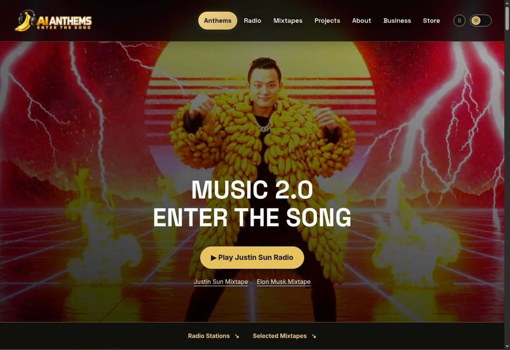
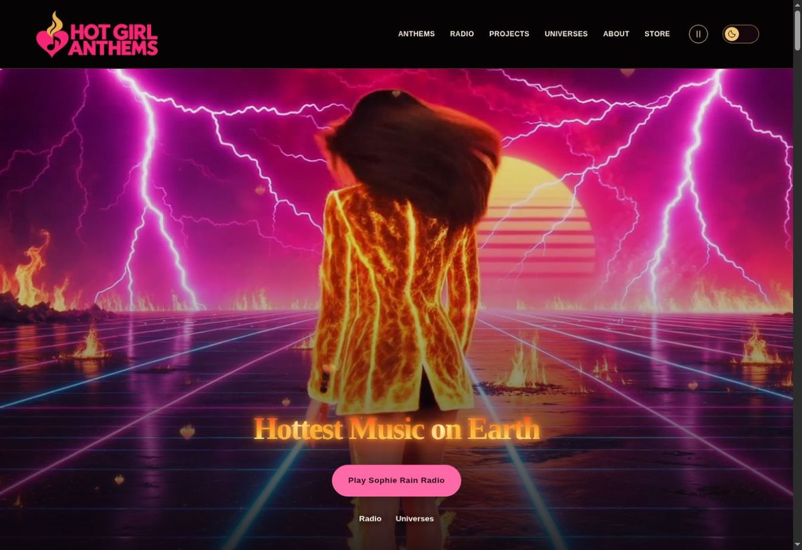

# Alex Julian — Building AI Anthems

**Music 2.0 — Enter the Song.**

> Human is the star, AI is the amplifier, nature is the stage.

I’m an AI music producer and the founder of **AI Anthems**. I create original songs, cinematic music videos, and software experiences through AI-assisted development—bringing music, visual worlds, and human–AI creativity together.

## AI Anthems · The flagship

**A song can become an entire world.** [AI Anthems](https://aianthems.com) is my flagship music platform: original releases, full-length music videos, searchable catalogs, mixtapes, and radio built around people, ideas, and cultural moments.

[Explore the music](https://aianthems.com/anthems) · [Find a station](https://aianthems.com/radio) · [Musical marketing](https://aianthems.com/business/musical-marketing)

## More musical worlds

### SI Anthems

[The soundtrack of the Super Intelligence Age](https://sianthems.com)—songs and cinematic worlds exploring technology, ambition, and imagined futures.

### Hot Girl Anthems

[Glamour, fantasy fashion, and cinematic music](https://hotgirlanthems.com)—extravagant visual storytelling, character-led anthems, and themed listening experiences.

## What I’m building

- **Music publishing, catalogs, and radio — live.** Original songs and videos with search, individual anthem pages, mixtapes, and curated stations across the music platforms.
- **[Musical Astrology](https://hotgirlanthems.com/projects/musical-astrology) — live and growing.** Twelve zodiac anthems and an interactive sky wheel connect celestial selections with symbolism and available music. The wider course is still in development.
- **[ENTER THE SONG](https://aianthems.com/enter-the-song) — preparing a controlled pilot.** An invitation for possible participation in future AI-assisted music videos. Applications are currently closed. Interactive musical worlds and hybrid human–AI concerts are future ambitions.

**Stack:** Next.js · TypeScript · React · Supabase · Vercel · Cloudflare R2 · Playwright

## Attention, practice, and the living world

My educational projects carry the same interest in human agency into everyday practice:

- **[AI Yoga Masters](https://aiyogamasters.com)** — educational practices for using AI with greater attention and discernment. A live school with 64 lessons, yoga flows, meditations, and optional browser-local reading progress. [Public repository](https://github.com/aianthems/ai-yoga-masters).
- **[Tree Yoga School](https://treeyogaschool.com)** — nature-centered yoga education, with outdoor practices, a Tree Library, a Champion Tree Map, and guides to trees you can visit. [Public repository](https://github.com/aianthems/tree-yoga-school).

## Build something extraordinary with me

I welcome **creative collaborators, developers, and potential partners** interested in original music, cinematic storytelling, and thoughtful human–AI experiences.

[contact@aianthems.com](mailto:contact@aianthems.com)
